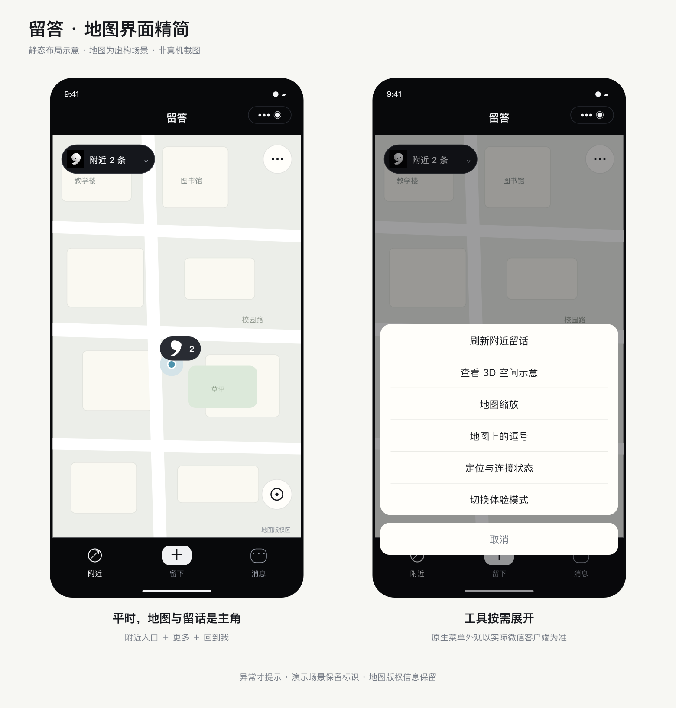

# 地图界面精简

> 初代微信小程序历史文档。当前 App 开发请看 [仓库首页](../README.md)。

日期：2026-10-26。关联 [Issue #2](https://github.com/Vans66660/liuda/issues/2)。

## 常驻界面

- 左上角“附近 N 条”：结合品牌逗号与附近列表入口；无留话时通往当前空状态对应的操作。
- 右上角“更多”：使用微信原生操作菜单，收纳地图工具。
- 右下角回到当前位置：一个 46px 圆形按钮；留言卡片或列表展开时隐藏，为内容让出空间。
- 地图逗号、POI 文字和“附近 / 留下 / 消息”底部导航保留。

正常真实二维地图不再常驻显示“我的位置 GPS”、精度、热度说明、刷新、加减缩放、3D 切换及底部连接状态条。

## 工具入口

“更多”中包含：刷新留话、3D 示意/二维地图切换、逗号说明、定位与连接状态、体验模式切换。真实二维地图另提供“地图缩放”子菜单作为手势缩放的辅助入口。最多六项，不增加常驻地图浮层。

精度、定位时效和联机状态仍持续维护；用户在“定位与连接状态”中按需查看。定位失效、精度不足时出现可点击提示；网络或加入试用提示在有内容时显示于顶部，空内容时使用底部原有操作提示，减少重复。

演示街区保留“虚构场景”标识，真实定位的 3D 视图保留“空间示意 / 非真实建筑”标识。底部卡片向上预留 30px 给原生地图版权信息，不覆盖或删除底图标识。

## 范围与状态

- 本轮只修改地图页 WXML、WXSS、客户端菜单及提示状态，更新入门文档。
- 定位采集、现场权限、留言数据、云函数和数据库配置均未变更。
- 原留言卡片的关闭、回复、展开、同地点选择等操作保留。
- 进行了 JavaScript 语法与 Git 差异格式检查。未运行自动化、模拟器或真机功能测试；不能据此声称性能已经改善。
- 重新编译并扫码预览客户端即可加载本次更新，无需重新部署云函数。

## 静态设计示意

下图使用虚构地图和示例内容展示布局关系，为配合源码审阅绘制的设计示意，不是真机截图或实际运行验证。

图中的原生操作菜单外观仅作示意，以实际微信客户端显示为准。

## 后续：当前位置可见性

10 月 26 日进一步缩小逗号并改用固定针脚、置顶蓝点，见 [位置显示说明](marker-location-clarity.md)；本页静态图为此前入口布局版本，最新标记样式以该说明为准。
