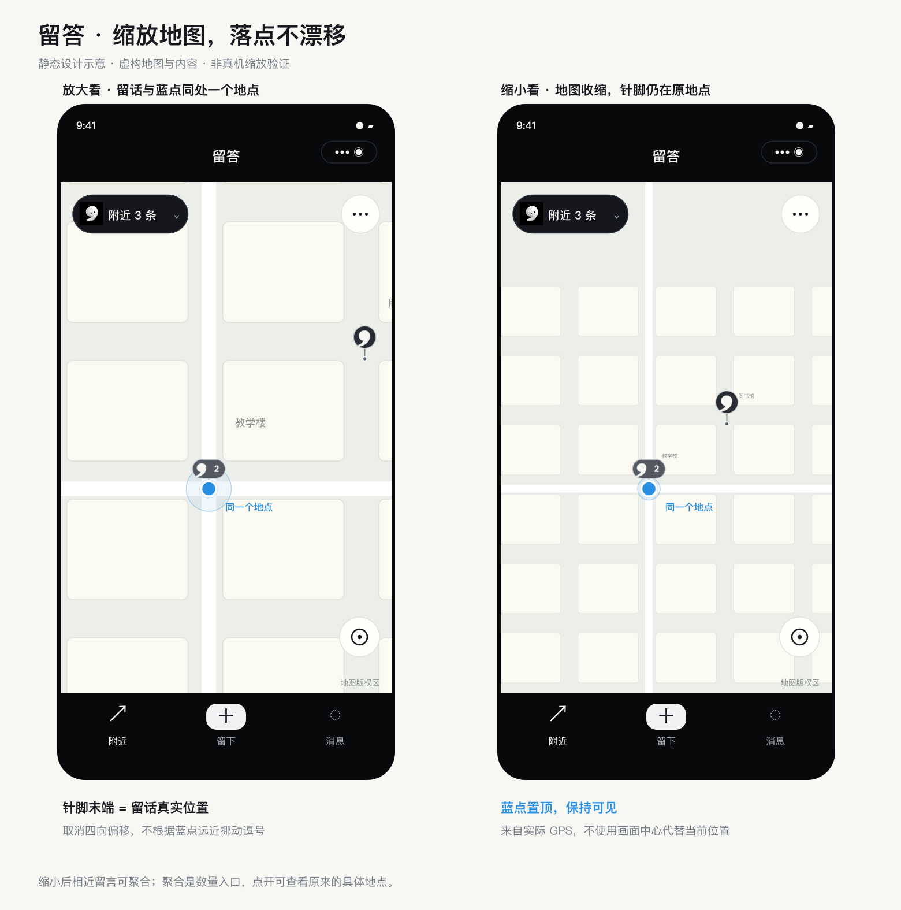

# 逗号与当前位置的显示

更新：2026-10-26，客户端源码已修改。关联 [Issue #2](https://github.com/Vans66660/liuda/issues/2)、[PR #3](https://github.com/Vans66660/liuda/pull/3)。

## 当前设计：固定针脚，蓝点置顶

- 普通 / 有回应 / 热门的可见高度为 **22 / 26 / 30px**，聚合数量增加 16px 数字区域，最多显示 `9+`。
- 每个二维留言标记有固定的 12px 短针脚，末端锚定真实经纬度。缩放和走动不再触发图示四向偏移。
- 逗号与蓝点使用同一原生 marker 图层。蓝点保留 ID `0`，层级 `10000`；留言 ID 从 `1` 开始，普通层级为热度档，选中层级为 `100`。
- 关闭 `show-location` 的独立原生定位图示，避免两套蓝点。自定义蓝点以现有 GCJ-02 GPS 数据为准，位于实际位置，不跟随地图画面中心。定位过期时变淡，并沿用现有异常提示。
- 蓝点目前为白边圆点，不显示手机朝向。淡蓝精度圈继续按定位报告的精度绘制。
- 气泡位于针脚上方，避免在与蓝点同坐标时覆盖蓝点；点击气泡仍打开原有留言/列表。
- 3D 示意继续使用无针脚的小逗号，本轮未改其投影布局。

此前的“固定 52px 四向避让 + 留空细线”已移除：在较小缩放级别下，气泡与地点的视觉距离被放大，也会在阈值切换时显得换位。当前图示无需根据 GPS 距离或缩放值计算避让。

## 坐标与聚合

原生 marker 的经纬度始终取原留言/分组代表点；针脚末端始终是图片的同一个锚点，缩放只由原生地图处理。没有修改原始坐标、距离算法或到场条件。

缩小时，不同地点仍会按原规则合并为数量入口，代表点选自真实成员；聚合不等同于某一条留言。展开后，各条留言仍使用各自真实坐标。同地点聚合、热度、点击卡片和现场权限保持现有规则。

锚点与同图层 marker 的 `zIndex` 属性依据 [腾讯位置服务 map 组件说明](https://github.com/TencentLBS/tencentmap-miniprogram-skill/blob/main/references/map_component_guide.md#marker)。不再假定留言层级能控制独立 `show-location` 图示的显示顺序。

## 素材与查看

`map-marker-style.js` 与 PNG 生成器共用尺寸和锚点。`scripts/build-map-pins.cjs` 生成 120 个留言样式和 1 个定位蓝点，合计约 0.26MB。旧四向避让素材已删除；定位回调不生成图片。

图为虚构地图和生成 PNG 的静态组合，不是真机截图或缩放功能验证。

重新编译并扫码预览即可，无需部署云函数。重点观察同一地点在放大/缩小时的针脚末端、蓝点可见性、气泡点击和走动后的更新。

本轮仅执行 JavaScript 语法、Git 差异格式检查并目视查看静态图；未运行自动化、模拟器或真机功能测试。实际原生地图显示仍待手机确认。
