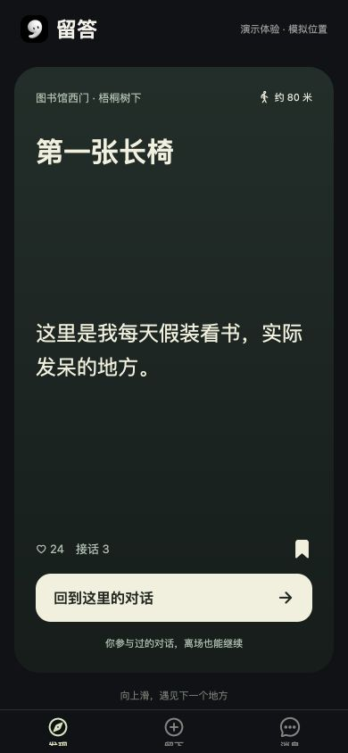

# 留答 App 原型

独立的 Expo / React Native App，入口是一屏一个地点的留话卡片。



## 手机预览

在 VS Code 打开本目录，在终端运行：

```sh
npm ci
npm start -- --go
```

电脑与手机连接同一 Wi-Fi，用手机相机扫描终端二维码，选择 Expo Go 打开。当前项目使用 Expo SDK 58，需要兼容版本的 Expo Go。若手机提示 SDK 不兼容，先核对版本。局域网不能互通时，可运行 `npm start -- --go --tunnel`（需要额外下载隧道工具并保持网络连接）。

按 `w` 或运行 `npm run web` 可看浏览器预览；手机手势、键盘和性能仍需在真机检查。

## 建议体验顺序

1. 首次启动点「先逛逛」。登录入口供流程预览，暂未接入真实账号。
2. 在「发现」上下滑动切换卡片。点右上角授权或刷新当前位置，点书签可收藏地点。
3. 在「留下」选择拍照、语音或文字。发布时会重新确认手机位置，照片和语音可以先预览。
4. 打开留言详情，查看两点之间的直线距离和方向。真实地点使用手机定位，内置卡片可模拟到场；参与后的对话可从「消息」继续。
5. 点发现页左上角进入个人中心，编辑本机昵称和头像，查看留话、对话和收藏。

文字、媒体和资料保存在当前设备。清除应用数据会丢失记录。高德地址解析使用开发服务端的 `AMAP_WEB_SERVICE_KEY`，可以在本地 `.env.local` 配置。

首屏品牌名与操作文案使用本地嵌入字体，加载失败时回退系统字体；来源、许可及固定文案子集更新步骤见 [字体说明](assets/fonts/README.md)。

## 检查

```sh
npm run typecheck
npm run lint
npx expo export --platform ios --output-dir /tmp/liuda-ios-export
```
